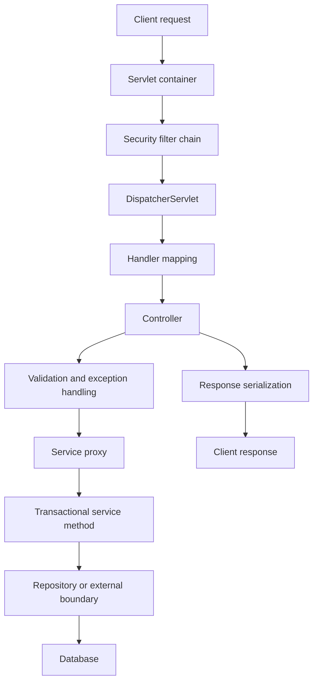

# Architecture sample: Spring Boot request flow

## Sixty-second explanation

A request first reaches the servlet container and passes through the configured filter chain, including security controls. `DispatcherServlet` resolves the handler and invokes the controller. The controller handles transport concerns such as request binding and validation, while business logic belongs in the service layer. A proxied service method may establish a transaction before calling repositories. The response is serialized after the controller returns, and centralized exception handling converts failures into consistent API responses.

## Add production depth

When explaining this diagram, add:

- one failure mode, such as authentication failure or database timeout;
- one observability signal, such as request latency, trace spans, or pool metrics;
- one transaction-boundary decision;
- one security control;
- one trade-off, such as synchronous simplicity versus asynchronous resilience.
